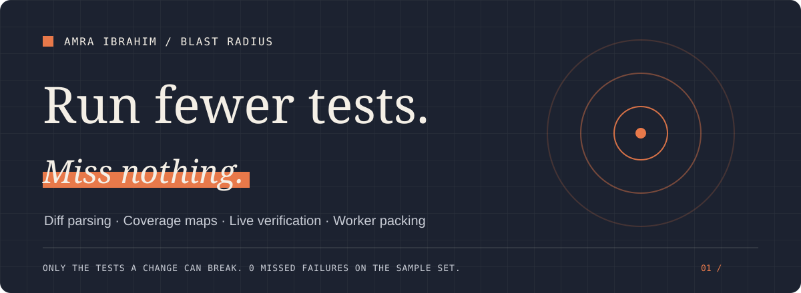

<h1 align="center">Blast Radius</h1>

<p align="center">Given a code change to sqlglot, pick the tests it can break and run only those.</p>

<p align="center">
  <a href="https://github.com/amraibrahim">GitHub</a> ·
  <a href="https://www.linkedin.com/in/amraibrahimr/">LinkedIn</a> ·
  <a href="mailto:ibrahimar2@vcu.edu">Get in touch</a>
</p>



<p align="center">
  
  
  
</p>

## The project

Blast Radius is my entry for the Blast Radius track of a hackathon. Each submission receives a batch of unified diffs against a pinned commit of [sqlglot](https://github.com/tobymao/sqlglot), the SQL parser and transpiler, whose suite has 1,620 tests. For each diff, it has to say which tests to run and how to split them across up to 8 workers.

A selection costs the runtime of its busiest worker plus 2 seconds per worker. Leaving out a test that fails costs 300 seconds, and the program's own CPU time is added to the score. The kit's starter runs every test on every commit. It never misses a failure, but it pays for the whole suite every time. The full brief is in [docs/challenge.md](docs/challenge.md), and the exact scoring rules are in [docs/scoring.md](docs/scoring.md).

This selector reads each diff structurally and maps the changed code to the tests that actually reach it. It then runs the cheap candidates against the patched tree to confirm which ones fail.

## Results

On the 30-commit sample set, measured with `python benchmark.py`:

| Approach | Simulated seconds | Missed failures |
| --- | --- | --- |
| Kit starter (run every test) | ~1614 | 0 |
| **Blast Radius** | **94.9** | **0** |
| Oracle (only the failing tests, best worker split) | 94.4 | 0 |

That is about 17× cheaper than the starter, and 0.5 s above the best possible score. The selector's own CPU time is about 1.2 s locally. The version-by-version history is in [docs/development-record.md](docs/development-record.md).

## How it works

1. **Rebuild the change.** The selector parses the unified diff and applies it to the pinned checkout, in memory, to get the old and new version of every changed file.
2. **Locate it structurally.** It compares the old and new ASTs to find exactly which functions, class bodies, table entries or imports changed. This way, a reformatted line or a moved definition does not select the whole file.
3. **Map changes to tests.** Maps built at image-build time from the pinned commit's own test run turn each change into candidate tests:
   - per-test line coverage, recorded with `sys.monitoring` (including `PY_START`, so one-line lambdas count)
   - class instantiation, file reads and directory listings
   - a class-table access profile: which keys of dialect tables like `TRANSFORMS` each test reads
   - a comparison profile that proves some operator swaps cannot change any test's result
4. **Verify the cheap candidates.** `verify_driver.py` estimates whether running a candidate now costs less than listing it. Cheap candidates run against the patched tree in warm forked children (`verify.py`), and only the ones that really fail are kept. Expensive candidates are listed without being run.
5. **Pack the workers.** The final selection is scheduled onto 1 to 8 workers, using whichever worker count costs least.

The maps come only from the pinned commit, never from the sample answers. The track's rules forbid looking up answers by patch.

## Built with

- Python 3.13 (`ast`, `sys.monitoring`, `os.fork`)
- [sqlglot](https://github.com/tobymao/sqlglot) at commit `eb11aec`, with its pytest and unittest suite
- Docker, matching the scorer's linux/amd64 image and resource limits

## Run locally

Use Python 3.13. Run these commands from the project folder.

Fetch sqlglot at the pinned commit and install the labeled package set:

```sh
python3 tools/fetch_sqlglot.py eb11aec4be8cb2122afe713a4816662c3f0fb2fa .build/sqlglot
python3 -m venv .build/venv
.build/venv/bin/pip install -r requirements.lock
```

Score the selector natively on the sample set and run the unit checks:

```sh
PATH=$PWD/.build/venv/bin:$PATH .build/venv/bin/python benchmark.py
.build/venv/bin/python test_selector.py
```

`benchmark.py --static` skips the live verification step, and `BR_VERBOSE=1` explains each selection on stderr.

To run the image exactly as the scorer does (no network, 2 CPUs, 4 GB, read-only disk), you need Docker and make:

```sh
make sample   # build, run on the 30 sample commits, and score
make check    # output format only
```

The committed `index.json.gz` is current. You only need to rebuild it if you change the tooling, and the steps for that are in [docs/development-record.md](docs/development-record.md).

## Repository guide

| Path | Purpose |
| --- | --- |
| [`selector.py`](selector.py) | Entry point: diff parsing, structural change detection, candidate selection, and worker packing |
| [`verify_driver.py`](verify_driver.py) | Cost model that decides which candidates are worth running |
| [`verify.py`](verify.py) | Runs candidate tests against the patched tree in forked children |
| [`index.json.gz`](index.json.gz) | Coverage, instantiation, and profile maps built from the pinned commit |
| [`tools`](tools) | Map builders (`build_*.py`, `compact_index.py`) and calibration and soundness checks |
| [`benchmark.py`](benchmark.py) | Native sample score with per-commit excess over the oracle |
| [`test_selector.py`](test_selector.py) | Unit checks for diff handling, scheduling, and sample safety |
| [`score.py`](score.py), [`sample`](sample), [`Makefile`](Makefile) | The track kit's local scorer, sample commits, and run targets |
| [`docs`](docs) | Track brief, scoring rules, and development record |

## Connect

[LinkedIn](https://www.linkedin.com/in/amraibrahimr/) · [GitHub](https://github.com/amraibrahim) · [Email](mailto:ibrahimar2@vcu.edu)
